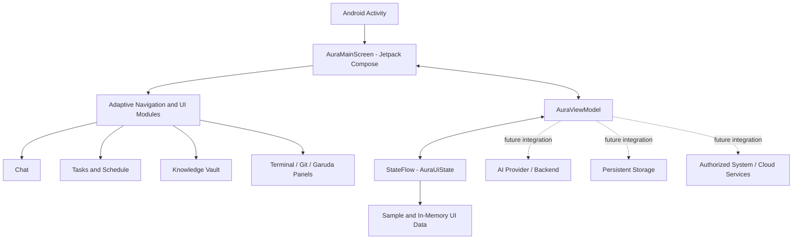

<div align="center">

# ⚡ AURA AI
### The Hybrid OS Workstation Concept

**One adaptive cockpit for AI, productivity, and Linux-inspired workflows.**

An ambitious Android-first interface that brings an AI workspace, personal productivity tools, developer utilities, and a Garuda Linux / Hyprland-inspired visual language into one unified experience.

<p>
  <a href="https://github.com/kr9528104/hybrid-os-with-powerful-linux/stargazers"></a>
  <a href="https://github.com/kr9528104/hybrid-os-with-powerful-linux/network/members"></a>
  
  
  
  
</p>

[Explore the Repository](https://github.com/kr9528104/hybrid-os-with-powerful-linux) · [Report a Bug](https://github.com/kr9528104/hybrid-os-with-powerful-linux/issues) · [Request a Feature](https://github.com/kr9528104/hybrid-os-with-powerful-linux/issues)

</div>

---

## ✨ The Vision

What if your everyday workspace felt less like a collection of apps and more like a command center?

**Aura AI** is the interface concept behind this repository: a unified workspace where conversations, tasks, schedules, knowledge, developer utilities, and Linux-inspired system panels live side by side. Its visual direction takes inspiration from the **Garuda Dragonized** aesthetic and **Hyprland / Waybar** desktop workflows—deep obsidian surfaces, electric cyan, violet, magenta, and crisp information-dense panels.

The long-term direction is a hybrid experience: AI-assisted productivity connected to real tools and, eventually, carefully permissioned system integrations.

> **Built around one idea:** your tools should work together, your workspace should adapt to your screen, and important actions should remain under your control.

## 🧭 At a Glance

| Area | What the current project contains |
|---|---|
| Project identity | Repository: `hybrid-os-with-powerful-linux`; Android application name: **Aura AI** |
| Application platform | Android application with adaptive mobile, tablet, and wide-screen layouts |
| UI framework | Kotlin + Jetpack Compose + Material 3 |
| Design direction | Dark, neon-accented interface inspired by Garuda Linux and Hyprland |
| Minimum Android version | Android 7.0 (API 24), as configured in the app module |
| Current maturity | Early prototype / interface and interaction demo; not a production Linux operating system |

## 🚀 Workspace Modules

The current interface is organized into focused modules. The descriptions below distinguish the UI that exists from integrations that still need implementation.

### 💬 AI Workspace

A conversation-first interface with model selection controls, message history, attachment controls, search controls, and a web-browsing toggle in the UI.

- Chat-style message timeline
- Model selector UI
- Attachment and conversation-export UI
- Draft and structured-response widgets
- Voice-recording control in the interface

**Current implementation note:** the inspected ViewModel generates sample/local responses. A live AI-provider request pipeline, real speech-to-text, and text-to-speech should not be assumed to be operational yet.

### ✅ Tasks & Productivity

A task workspace with task categories, due dates, priorities, completion toggles, and add/delete interactions.

### 🗓️ Schedule & Calendar

A calendar-style agenda view designed for meetings, events, and daily planning. The repository currently seeds sample events; live calendar synchronization requires a real provider integration and authorization flow.

### 🧠 Knowledge Vault

A resource area for browsing and previewing pinned knowledge items. It provides a foundation for a searchable personal knowledge workspace; durable indexing and cross-session retrieval should be verified or implemented before relying on it as long-term memory.

### ⌨️ Developer Terminal Concept

A terminal-inspired panel with command history, process cards, and script templates.

**Important:** the current command evaluator returns predefined demo output. It does **not** execute arbitrary shell commands on a host Linux system. Do not use it as a real system terminal or for production administration.

### 🧩 Open-Source & Git Workspace

A workspace concept for repository cards, branch information, staged/unstaged file views, and Git-related controls.

**Current implementation note:** the inspected state and actions are simulated in the app's ViewModel. Real Git operations, remote repository access, and authentication must be integrated separately.

### 🐉 Garuda Workstation Hub

A Linux-inspired control-panel concept for package status, snapshots, CPU governor, and ZRAM options.

**Current implementation note:** these controls currently update in-memory UI state. They do not install packages, create BTRFS snapshots, change kernel governors, or configure ZRAM on a real Linux machine.

## 🎨 Design Philosophy

Aura's visual identity is built around a high-contrast, focused workstation aesthetic:

- **Deep-space surfaces** for a calm, low-distraction workspace.
- **Electric cyan, violet, and magenta** for active states and visual hierarchy.
- **Glass-like cards and subtle borders** to separate dense information without clutter.
- **Responsive composition** that changes navigation and panel layout for mobile, tablet, and wide screens.
- **A developer-console feel** inspired by Garuda Linux, Hyprland, and Waybar.

The app currently uses a mobile navigation drawer and bottom navigation, a two-column tablet layout, and a three-column wide-screen dashboard.

## 🧱 Technology Stack

The following technologies are declared in the repository's Gradle configuration and version catalog:

| Technology | Role |
|---|---|
| Kotlin | Primary application language |
| Android Gradle Plugin | Android build configuration |
| Jetpack Compose | Declarative UI |
| Material 3 | UI components and theming |
| Kotlin Coroutines / Flow | Asynchronous work and observable UI state |
| AndroidX Lifecycle | ViewModel and lifecycle-aware state collection |
| Room | Database libraries declared for future/local data work |
| Retrofit + OkHttp | HTTP client stack declared in dependencies |
| Moshi | JSON serialization |
| Firebase AI | AI SDK dependency declared in the app module |
| Firebase App Check | App Check dependencies declared in the app module |
| KSP | Kotlin symbol processing (Room / Moshi code generation) |
| JUnit, Robolectric, AndroidX Test | Test dependencies |

> A dependency being declared does not automatically mean its feature is fully wired into the user experience. Check the actual implementation and configuration before treating an integration as production-ready.

## 🏗️ Project Architecture

At a high level, the current app follows a Compose + ViewModel state-driven structure:



### Repository layout

```text
hybrid-os-with-powerful-linux/
├── app/
│   ├── src/main/
│   │   ├── java/com/example/
│   │   │   ├── MainActivity.kt
│   │   │   ├── ui/              # Compose screens, components, and theme
│   │   │   ├── viewmodel/       # AuraViewModel and UI state
│   │   │   └── ...              # Models and supporting app code
│   │   └── res/                 # Android resources
│   └── build.gradle.kts
├── gradle/
│   └── libs.versions.toml       # Dependency and plugin versions
├── .env.example                 # Example secret configuration
├── build.gradle.kts
├── gradle.properties
├── metadata.json
└── settings.gradle.kts
```

## ⚙️ Getting Started

### Requirements

- Android Studio version compatible with the Android Gradle Plugin configured in this repository.
- Android SDK Platform **36** (the app config targets API 36; compile configuration uses 36.1).
- A supported JDK for the configured Android Gradle Plugin.
- An Android device or emulator running **Android 7.0 / API 24 or newer**.

### 1. Clone the repository

```bash
git clone https://github.com/kr9528104/hybrid-os-with-powerful-linux.git
cd hybrid-os-with-powerful-linux
```

### 2. Open the project

1. Launch Android Studio.
2. Select **Open** and choose the cloned repository folder.
3. Allow Gradle to sync and install any missing Android SDK components.
4. Select the `app` run configuration and launch it on an emulator or connected Android device.

### 3. Build a debug APK

The repository configures the Gradle wrapper distribution as **Gradle 9.3.1**. If the wrapper launch script (`gradlew`) is present in your local checkout, run:

```bash
./gradlew :app:assembleDebug
```

If the wrapper launch script is not present, use Android Studio's Gradle tasks or install a compatible Gradle version and run:

```bash
gradle :app:assembleDebug
```

The expected debug APK output location is:

```text
app/build/outputs/apk/debug/app-debug.apk
```

> Build success has not been independently verified as part of preparing this README. Resolve any SDK, signing, or dependency errors reported by your local Gradle build.

## 🔐 Configuration & Security

The repository includes an `.env.example` file with a commented `GEMINI_API_KEY` example and configures the Secrets Gradle Plugin to read `.env`.

1. Create your local environment file if your development setup requires it:

   ```bash
   cp .env.example .env
   ```

2. Add secrets locally only when the corresponding integration is implemented and enabled.
3. Keep `.env`, signing keys, service-account files, and private tokens out of Git.
4. Never paste production secrets into source code, screenshots, issues, or public commits.
5. For a production mobile app, prefer a secured backend or short-lived credentials over embedding a long-lived provider secret in an APK.

The Android manifest currently declares the `INTERNET` permission. Do not assume microphone, contacts, calendar, file-system, accessibility, or device-administration access is available; add only the permissions actually required, explain their use, and request runtime consent where Android requires it.

## 🧪 Testing

Test dependencies are present in the Gradle configuration, including JUnit, Robolectric, and AndroidX UI/instrumentation test libraries.

Before merging changes, a useful baseline is:

```bash
# Unit tests
./gradlew :app:testDebugUnitTest

# Android instrumentation tests (requires a connected device or emulator)
./gradlew :app:connectedDebugAndroidTest

# Debug build
./gradlew :app:assembleDebug
```

Use the equivalent `gradle` commands if your checkout does not contain the wrapper script. These commands describe the recommended validation workflow; they are not a claim that every test suite is already implemented or passing.

## 🛣️ Roadmap

The following are development directions—not claims that these features are already complete.

- [ ] Connect the chat pipeline to a real AI provider with robust error handling, streaming, and model configuration.
- [ ] Add secure, user-controlled authentication and explicit approval for sensitive actions.
- [ ] Implement durable local storage for conversations, tasks, settings, and knowledge resources.
- [ ] Add real speech-to-text and text-to-speech with clear microphone controls.
- [ ] Connect calendar and communication services through OAuth and official APIs.
- [ ] Replace demo terminal output with a permissioned, audited execution bridge—or keep the terminal explicitly simulated.
- [ ] Connect Linux workstation controls through a separately installed, authenticated companion agent.
- [ ] Implement real Git operations with scoped credentials and safe handling of destructive actions.
- [ ] Add automated tests for navigation, state restoration, permissions, storage, and integration failures.
- [ ] Publish screenshots, architecture notes, release builds, and a clear support policy.

## 🤝 Contributing

Contributions, issues, design feedback, and practical implementation ideas are welcome.

1. Fork the repository.
2. Create a focused feature branch.
3. Keep changes small and document new permissions or external services.
4. Run the relevant tests and build before opening a pull request.
5. Include screenshots or a short recording for UI changes.

For substantial changes, open an issue first so the design and integration approach can be discussed.

## 🐛 Issues & Feature Requests

- [Open an issue](https://github.com/kr9528104/hybrid-os-with-powerful-linux/issues)
- [Browse the source](https://github.com/kr9528104/hybrid-os-with-powerful-linux)

When reporting a bug, include the Android version, device/emulator details, steps to reproduce, expected behavior, actual behavior, and relevant redacted logs. Never attach API keys or personal data.

## 📄 License

No `LICENSE` file was visible in the repository when this README was prepared. Until a license is added, do not assume that the source is licensed for reuse, redistribution, or modification by others. Add an explicit open-source license if that is the project's intention.

## ⚠️ Project Status & Disclaimer

This repository currently contains an **Android application prototype** with an adaptive Compose interface and a Linux-workstation-inspired concept. It is **not currently a bootable Linux distribution, a replacement for Garuda Linux, a Linux kernel, or a verified system-administration tool**.

Several screens and interactions are backed by sample or in-memory state. Real AI, operating-system control, cloud synchronization, calendar/email access, terminal execution, and Git operations must be implemented and security-reviewed before being relied upon.

**Aura AI is an independent project and is not affiliated with or endorsed by the Garuda Linux, Hyprland, or Android projects.**

---

<div align="center">

### ⚡ Build a workspace that feels like the future.

**Explore. Experiment. Improve.**

Made with curiosity and a passion for powerful, user-controlled computing.

[⭐ Star this repository](https://github.com/kr9528104/hybrid-os-with-powerful-linux) · [🍴 Fork it](https://github.com/kr9528104/hybrid-os-with-powerful-linux/fork)

</div>
